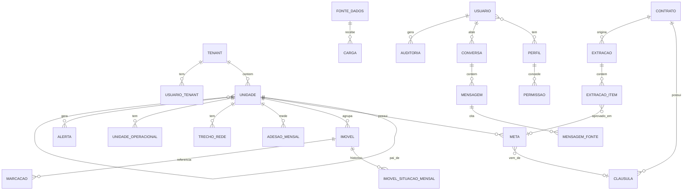

# 4. Modelo de dados (proposta)

> **Status:** proposta derivada dos vídeos e do fluxo relatado. Deve ser **comparada com o esquema real**
> do volume `aurora_postgres-dados` (ver [pendências](06-pendencias.md)) e ajustada.
> Banco: PostgreSQL + PostGIS.

## 4.1 Diagrama

## 4.2 Entidades

### Estrutura e escopo
| Tabela | Campos principais | Observações |
|--------|-------------------|-------------|
| `tenant` | id, nome, slug, status | Cliente isolado ("Grupo Saneamento Exemplo"); substitui `grupo`. **Todas as tabelas abaixo têm `tenant_id` e RLS** ([detalhes](08-multitenancy-e-acesso.md)) |
| `unidade` | id, tenant_id, pai_id, tipo (`CONCESSAO`, `MUNICIPIO`, `SETOR_COMERCIAL`), nome, geom (polygon) | Hierarquia; `geom` para o mapa |
| `unidade_operacional` | id, unidade_id, tipo (`ETE`, `EEE`), nome, geom (point) | Camada do mapa |

### Contrato e IA
| Tabela | Campos principais | Observações |
|--------|-------------------|-------------|
| `contrato` | id, unidade_id (concessão), numero ("001/2025"), arquivo_pdf, hash, enviado_por, enviado_em | PDF guardado para abrir na página |
| `clausula` | id, contrato_id, numero ("7.2"), pagina, trecho | Fonte de cada meta |
| `extracao` | id, contrato_id, status (`PROCESSANDO`, `PENDENTE`, `APROVADA`, `PARCIAL`, `REJEITADA`, `ERRO`), modelo_ia, versao_prompt, criada_em | Uma por envio/versão |
| `extracao_item` | id, extracao_id, tipo, unidade_alvo_id, meta_pct, alerta_pct, vig_ini, vig_fim, clausula_numero, pagina, trecho, valor_ia (jsonb), valor_final (jsonb), status (`PENDENTE`, `APROVADO`, `EDITADO`, `REJEITADO`), decidido_por, decidido_em | Preserva original da IA e decisão humana |

### Metas
| Tabela | Campos principais | Observações |
|--------|-------------------|-------------|
| `meta` | id, unidade_id, meta_pct, alerta_pct, vig_ini, vig_fim (nullable), origem (`CONTRATO`, `MANUAL`), clausula_id (nullable), extracao_item_id (nullable), criada_por | Herança resolvida na consulta |

### Comercial e GIS
| Tabela | Campos principais | Observações |
|--------|-------------------|-------------|
| `imovel` | matricula (PK), setor_id, geom (point), localizacao_aproximada (bool) | Sem nome e sem endereço |
| `imovel_situacao_mensal` | matricula, competencia, situacao (`LIGADO`, `FACTIVEL`, `CORTADO`, `SEM_REDE`) | Base da adesão e do "sem ligação há" |
| `adesao_mensal` | unidade_id, competencia, ligados, com_rede, adesao_pct, rede_mudou (bool) | Pré-calculada por nível |
| `trecho_rede` | id, unidade_id, geom (linestring), status (`CONFIRMADA`, `PRESUMIDA`) | Camada de rede |
| `marcacao` | id, geom, titulo, observacao, matricula (nullable), criada_por, criada_em, status | Visita marcada no mapa |

### Alertas e dados
| Tabela | Campos principais | Observações |
|--------|-------------------|-------------|
| `alerta` | id, tipo, severidade (`CRITICO`, `ATENCAO`), unidade_id/fonte_id, mensagem, estado (`ABERTO`, `RECONHECIDO`, `RESOLVIDO`), desde, reconhecido_por, resolvido_em | Reavaliado a cada 15 min |
| `fonte_dados` | id, nome, tipo, atraso_max_horas, ativa | "Sistema comercial (demo)" |
| `carga` | id, fonte_id, competencia, iniciada_em, concluida_em, linhas, status | Alimenta "dados de <mês>" e atraso |

### Acesso, assistente e auditoria
| Tabela | Campos principais | Observações |
|--------|-------------------|-------------|
| `usuario` / `usuario_tenant` | id, nome, email, senha_hash, ativo / usuario_id, tenant_id | Usuário pode estar em vários tenants (a confirmar) |
| `perfil` / `permissao` / `perfil_permissao` / `usuario_perfil` | | Permissões por perfil; perfis do sistema com `tenant_id` nulo |
| `usuario_escopo` | usuario_id, tenant_id, unidade_id | Onde o usuário atua (inclui descendentes) |
| `convite` / `sessao` | | Ciclo de vida de usuário e sessões |

> Tabelas completas de acesso, em [8. Multi-tenant, perfis e acesso](08-multitenancy-e-acesso.md#810-modelo-de-dados-acréscimos).
| `conversa` | id, usuario_id, titulo, criada_em | |
| `mensagem` | id, conversa_id, papel (`USUARIO`, `ASSISTENTE`), texto, feedback | |
| `mensagem_fonte` | id, mensagem_id, ordem, rotulo, consulta, linhas (jsonb) | Chips numerados e linhas expansíveis |
| `auditoria` | id, usuario_id, acao, entidade, entidade_id, parametros (jsonb), linhas, em | Exportações, aprovações, metas |

## 4.3 Índices e restrições sugeridos

- `unidade(pai_id)`, `meta(unidade_id, vig_ini, vig_fim)` com restrição de não sobreposição por unidade.
- `imovel_situacao_mensal(competencia, situacao)` e `(matricula, competencia)` único.
- Índices **GiST** em todas as colunas `geom`.
- `adesao_mensal(unidade_id, competencia)` único.
- Parcial em `alerta(estado) WHERE estado <> 'RESOLVIDO'` para evitar duplicidade.

## 4.4 Consultas-chave

- **Adesão do nível:** soma de `ligados` e `com_rede` das unidades filhas na competência.
- **Meta aplicável:** subir a hierarquia até achar meta vigente na competência.
- **Sem ligação:** imóveis com `situacao IN ('FACTIVEL','CORTADO')` na competência, filtrados por escopo.
- **Ritmo:** média das variações de `ligados` nos 6 meses anteriores onde `rede_mudou = false`.

## 4.5 A validar com o banco antigo

- Nomes reais de tabelas/colunas e se havia tabela de extração/aprovação.
- Uso de PostGIS (colunas `geometry`).
- Como a hierarquia de unidades e a herança de metas eram guardadas.
- Se `adesao_mensal` era tabela ou visão materializada.
- Estrutura de conversas e de fontes do assistente.
